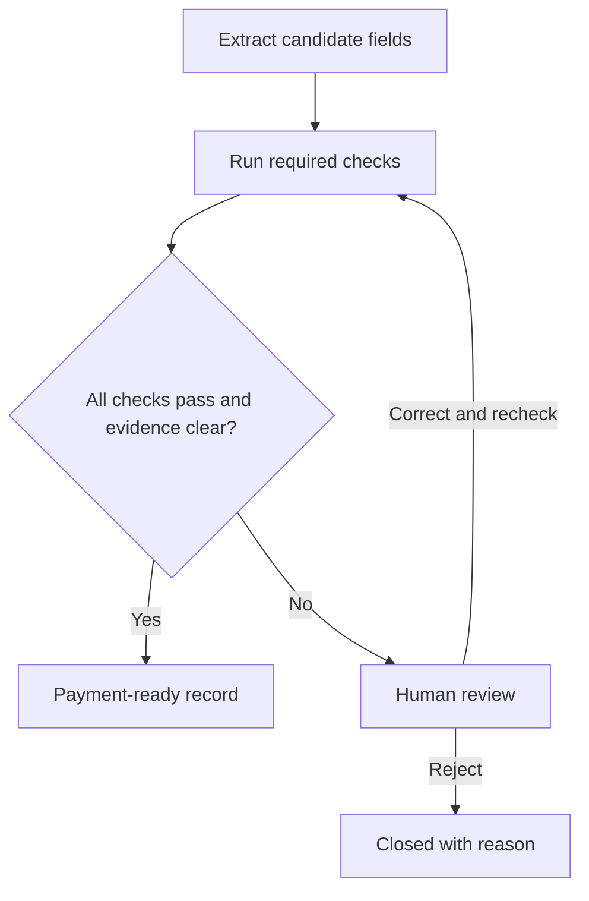

# FinFlow AI architecture

**Proposed design · Phase 1**

User → EJS frontend → Express routes → Controllers → AI/automation services → MongoDB (via Mongoose models).

EJS will render HTML on the server. A browser form will submit an HTTP request to Express. Middleware will check the request before a controller delegates work to a service. The controller will then render a view with the resulting state.

## Processing one invoice

1. Multer will stage a PDF in private storage. The invoice will receive an internal tracking ID.
2. The PDF and extraction services will ask Gemini for candidate fields such as vendor identity, invoice number, currency, quantities and totals. Missing or ambiguous fields will carry a review reason.
3. Deterministic checks will normalize identifiers, verify the vendor against the approved vendor record, check duplicate invoice numbers within that vendor, and compare line amounts and currency with the purchase order. Three-way matching will compare billed quantities with both the order and recorded goods receipts where required.
4. The workflow engine will collect failures and model flags. A missing receipt, conflicting vendor identifiers, uncertain extraction or a possible duplicate will place the invoice on hold. A reviewer will inspect the PDF and evidence, record a decision and reason, and send corrected data back through the checks. Rejected items will stay out of the ready queue.
5. A record that passes all required checks and reviews may be marked payment-ready for downstream finance staff. That state describes a validated record. Authority to release funds stays with finance outside this system.
6. Audit events will link the invoice, checks, rule outcomes, reviewer and timestamps. Reports will use those events to explain how a record reached its state.

## AI and financial rules

Gemini can interpret varied document layouts and suggest anomalies. Its output will be treated as untrusted data. The rule engine will perform comparisons against stored vendor, order and receipt records using explicit business policy. For example, even if Gemini reads a quantity clearly, an invoiced quantity above the received quantity will trigger a hold when receipt matching is required. An unavailable model or missing reference record will also leave the case pending review.

## Folder responsibilities

| Folder | Planned responsibility |
|---|---|
| config | Hold environment-specific database setup. |
| routes | Map HTTP methods and paths to controller actions. |
| controllers | Read requests, call services and select a view or response. |
| models | Describe stored records and relationships using Mongoose. |
| services/ai | Call Gemini, extract candidate fields and flag suspicious patterns. |
| services/automation | Run repeatable checks, coordinate state changes and route exceptions. |
| services | Prepare PDFs for extraction. |
| middleware | Handle uploads, access checks and request errors at the Express boundary. |
| views | Render EJS pages and shared partials as HTML. |
| public | Serve CSS, browser JavaScript and public image assets. |
| uploads | Stage private PDFs outside public assets. Git retains only the directory marker. |
| utils | Share workflow constants, field validators and formatting helpers. |
| tests | Reserve coverage for intake, matching and approval decisions. |

## Record relationships

An invoice references one vendor and may reference a purchase order. A goods receipt refers to order lines. An approval associates an invoice with a reviewer (User), a reason and a decision. AuditLog records events against the invoice ID. Future reports will derive counts and processing times from those records.
